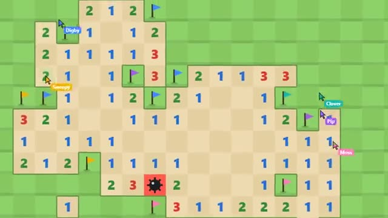

# Mine Sweep

One huge minefield. Clear it as a team. A multiplayer starter game from [Multiplayer Agent](https://multiplayeragent.com): 2D, co-op, 1–6 players, with bot sweepers that fill empty seats.

## How it plays

Everyone digs the same field at once, and you can see each other's cursors. Numbers tell you how many mines touch a square: flag the mines, dig the rest. Every boom costs the team one of three lives. Clear the field fast to get on the board.

**Controls:** Click to dig, right-click to flag, click a number to dig around it; on touch, tap to dig, long-press to flag (or switch with the Dig/Flag button), pinch to zoom.

## Make it yours in the Game Builder

Open the [Game Builder](https://multiplayeragent.com), choose **Start from a starter game** and pick Mine Sweep. It opens as version 1 in your studio, ready to play and publish. Then ask for changes, for example:

- Make it a snowy field with buried presents instead of mines
- Add a power-up square that shows three mines for ten seconds
- Give each player their own score for safe digs

## Run it yourself

1. Get a free publishable key (`pk_…`) at [multiplayeragent.com](https://multiplayeragent.com).
2. In `index.html`, put it in place of `pk_REPLACE_ME` in the `MP_CONNECT` block.
3. Open `index.html` in a browser. No build step and no server needed.

Without a key it still runs, offline with bot sweepers.

## How it is built

- One `index.html`. The comment at the top of the script maps the code and explains the multiplayer.
- The field size, mine count and lives are in `CONFIG`. The mines come from a seed and the first square dug, so the first dig is always safe.
- **Host-run rules:** The host's browser places the mines and checks every dig; if it leaves, the next player takes over.
- **Bots:** Bot sweepers dig and flag alongside you when the room is quiet.
- **Leaderboard:** The team's fastest clear.
- **Live sync:** Everyone's cursor, flag and dig shows up for the whole team.
- **Live ops:** The owner can change the mine count and lives without a new deploy.
- `?attract` runs it offline with bots only. The preview video is recorded from it.

## License

MIT.
